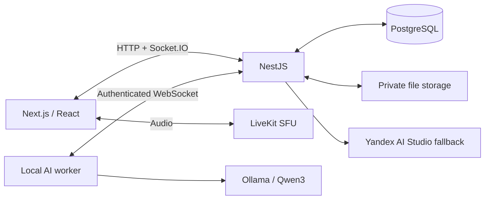

# PairUp

**Find a study partner. Stay focused. Learn together.**


PairUp is a collaborative learning platform that brings study-partner discovery, real-time communication, shared learning tools, and an AI assistant into one workspace.

The project grew out of a practical question: **how can we make it easier to start studying—and keep going—with another person?** Instead of switching between a messaging app, shared documents, a timer, and an AI service, participants can work together inside a study room.

This is a personal full-stack project and the foundation for a prospective master's thesis on an intelligent collaborative learning platform with AI-assisted partner matching and learning-material processing.

**Status:** a working prototype with persistent collaborative rooms. Partner recommendations and document processing are research and development goals, not completed features.

<br clear="right" />

## The product experience

1. **Discover a study opportunity.** Browse listings with a subject, learning goal, level, and preferred study format. Open a listing or its author's public profile to learn more.
2. **Connect with a partner.** Propose a session. Once the listing owner accepts, both participants can access its study room.
3. **Study in one place.** Use text and voice chat, shared notes, tasks, a whiteboard, and a synchronized Pomodoro timer.
4. **Ask Neuron for help.** The session host can invoke the AI assistant from the composer or select a message as context—for example, to translate a conversation or explain a topic.
5. **Return to your work.** Messages, uploaded materials, notes, tasks, and drawings remain available when the room is reopened.

An English practice listing also provides a direct path into chat for demonstrations.

## Implemented features

| Area | What works today |
| --- | --- |
| Discovery & profiles | Study listings, listing details, session proposals and acceptance, public profiles, profile editing, and profile previews inside chat. |
| Real-time chat | Persistent messages, delivery acknowledgements, duplicate protection, reconnection recovery, and cursor-based history loading in batches of 50. |
| AI assistant | Host-controlled requests, selected-message context, shared responses, local Ollama inference, and a configurable Yandex AI Studio fallback. |
| Voice | LiveKit-based audio rooms, microphone controls, participant indicators, and active-speaker feedback. Requires a configured LiveKit service. |
| Shared notes & tasks | Yjs-based collaborative text editing, autosave, note export, task management, and shared progress. |
| Whiteboard | Freehand drawing, lines, shapes, text, colors, stroke widths, element deletion, confirmed clearing, and SVG export. Completed strokes synchronize between participants. |
| Pomodoro | Shared server-based timing, start/pause/resume/reset, configurable focus and break intervals, and manual progression to the next interval. |
| Files & media | Upload progress and retry, drag-and-drop, document downloads, image previews, in-chat video playback, and separate document and media views. |
| Interface | Responsive layouts, light and dark themes, Russian and English localization with `next-intl`, device-language detection, and a saved language preference. |

## Engineering decisions

- **Persist before broadcasting.** Chat messages are committed to PostgreSQL before Socket.IO events are emitted. Client-generated request IDs make retries safe.
- **Keep room access on the server.** Private room endpoints validate membership. Browser authentication uses an HTTP-only session cookie backed by server-side session records; session-token hashes are stored in the database.
- **Use the right collaboration model.** Notes merge through Yjs. Version checks protect tasks and timer commands against stale updates. Independent whiteboard strokes have unique IDs, while a board generation prevents old writes from restoring a cleared drawing.
- **Avoid server-side timer ticks.** The server stores a deadline and paused remainder. Clients display the countdown using server time and a local monotonic clock.
- **Separate audio from application traffic.** Voice media travels through the LiveKit SFU, rather than the NestJS API or Socket.IO connection.
- **Keep private media cacheable.** Browser caching uses ETags and conditional requests, with room authorization checked before a `304` response. RTK Query manages application data; media bytes stay out of Redux.
- **Support local AI without exposing the inference server.** A worker connects outward to the backend over an authenticated WebSocket connection. Timed-out local jobs can fall back to the configured cloud provider, with one published result per job.

## Technology stack

| Layer | Technologies |
| --- | --- |
| Frontend | Next.js App Router, React, TypeScript, Tailwind CSS, shadcn/ui, next-intl |
| Client state & data | Redux Toolkit, RTK Query |
| Backend | NestJS, TypeScript, Socket.IO |
| Persistence | PostgreSQL, Prisma, persistent file storage |
| Collaboration & voice | Yjs, SVG whiteboard, LiveKit |
| AI | Ollama, Qwen3, Node.js worker, optional Yandex AI Studio fallback |
| Deployment & verification | Docker Compose, Caddy, Node.js tests, Playwright |



## Research direction

**Prospective thesis:** *Development of an intelligent collaborative learning platform with AI-assisted partner matching and automated learning-material processing.*

The main research focus is partner matching: how subject interests, learning goals, availability, and other relevant profile signals can help people find suitable study partners. The platform provides an environment in which matching approaches can later be implemented and evaluated.

Planned research includes comparing a baseline matching method with an AI-assisted approach and evaluating recommendation relevance, session acceptance, and participant feedback. Claims about reduced procrastination or improved learning outcomes will require a dedicated study; they are motivations for the project, not established results.

Further development includes full account registration, AI-assisted matching, document ingestion and summarization, and a structured session archive.

## Run locally

**Requirements:** Node.js 22 or newer, npm, and Docker with Compose. Ollama and LiveKit are optional for the corresponding features.

From the repository root:

```powershell
npm ci --prefix server
npm ci --prefix client

Copy-Item server/.env.example server/.env
Copy-Item client/.env.example client/.env.local

docker compose -f compose.local.yaml up -d
npm run db:generate --prefix server
npm run db:migrate --prefix server
```

Start the backend and frontend in separate terminals:

```powershell
npm run dev --prefix server
```

```powershell
npm run dev --prefix client
```

Open [localhost:3000](http://localhost:3000). Use **TEST** to explore the prototype; separate browser sessions receive separate participant identities. Presenter access uses the password configured in `server/.env`.

The email/password registration interface currently stops at email verification. Email delivery and production account registration are not implemented.

### Optional: local AI

Install Ollama, pull the model, and configure the worker:

```powershell
ollama pull qwen3:8b
npm ci --prefix worker
Copy-Item worker/.env.example worker/.env
npm start --prefix worker
```

The worker's `SERVER_URL` must point to the backend, and `WORKER_SECRET` must match the backend configuration. Sign in as Presenter and use **Ask Neuron** in a room. Cloud fallback requires the corresponding Yandex credentials and model URI.

For voice setup, see the [LiveKit deployment guide](deploy/VOICE.md).

## Verification

```powershell
npm run lint --prefix client
npm run build --prefix client
npm run build --prefix server
npm test --prefix server
```

Browser checks require the local frontend, backend, database, and Microsoft Edge:

```powershell
npm ci --prefix tools
npm run test:flow --prefix tools
npm run test:chat-history --prefix tools
npm run test:files --prefix tools
npm run test:profiles --prefix tools
npm run test:study-tools --prefix tools
npm run test:activities --prefix tools
```

These integration scenarios create isolated test data and cover participant access, real-time delivery, pagination, profiles, uploads, collaborative notes/tasks, whiteboard operations, and timer synchronization.

## Repository guide

| Path | Purpose |
| --- | --- |
| [`client/`](client/) | Frontend organized by product features, reusable UI, localization, and state management. |
| [`server/`](server/) | NestJS API, room authorization, real-time events, persistence, and database migrations. |
| [`worker/`](worker/) | Local AI worker connecting the backend to Ollama. |
| [`tools/`](tools/) | Browser integration checks and supporting utilities. |
| [`deploy/`](deploy/) | Hosting, HTTPS, voice, file storage, and collaboration documentation. |

Deployment uses Docker Compose and Caddy, with persistent database and upload volumes. See [hosting](deploy/HOSTING.md), [voice](deploy/VOICE.md), [study tools](deploy/STUDY_TOOLS.md), [files](deploy/FILES.md), and [profiles](deploy/PROFILES.md) for operational details.

The current deployment targets small study rooms. Large-scale production operation would require shared object storage, a distributed Socket.IO adapter and rate limiter, AI job orchestration, and further load testing. Large concurrency targets have not been validated.

---

**PairUp** is a product and research project by [jacio1](https://github.com/jacio1), combining frontend development, backend systems, real-time collaboration, and practical AI integration.
