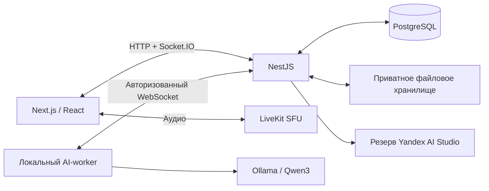

# PairUp

[English](README.md) · [Русский](README.ru.md)

**Найди напарника. Сосредоточься на учёбе. Достигайте большего вместе.**


PairUp — платформа совместного обучения, объединяющая поиск напарников, общение в реальном времени, учебные инструменты и AI-помощника в одном рабочем пространстве.

Проект вырос из практического вопроса: **как помочь людям начать учиться вместе и поддерживать регулярность занятий?** Вместо переключения между мессенджером, общими документами, таймером и AI-сервисом участники могут заниматься в одной учебной комнате.

Это личный full-stack проект и основа будущей магистерской работы об интеллектуальной платформе совместного обучения с AI-поддержкой подбора напарников и обработки учебных материалов.

**Статус:** работающий прототип с сохранением данных совместных комнат. Рекомендации напарников и обработка документов относятся к дальнейшей разработке и исследованию.

<br clear="right" />

## Как устроен продукт

1. **Найти подходящее объявление.** Посмотреть предмет, учебную цель, уровень и формат занятий. Открыть подробности объявления или публичный профиль автора.
2. **Договориться о занятии.** Предложить совместную сессию. После принятия приглашения автором оба участника получают доступ к учебной комнате.
3. **Заниматься в одном пространстве.** Использовать текстовый и голосовой чат, общие заметки, задачи, доску и синхронизированный таймер Pomodoro.
4. **Позвать Нейрона.** Ведущий может вызвать AI-помощника из поля ввода или выбрать сообщение в качестве контекста — например, для перевода переписки или объяснения темы.
5. **Вернуться к результатам.** Сообщения, загруженные материалы, заметки, задачи и рисунки доступны при повторном открытии комнаты.

Для демонстраций также предусмотрен прямой переход в чат из объявления для практики английского языка.

## Реализованные возможности

| Направление | Что работает сейчас |
| --- | --- |
| Объявления и профили | Список и подробности объявлений, предложение и принятие сессий, публичные профили, редактирование профиля и его просмотр в модальном окне чата. |
| Чат в реальном времени | Сохранение сообщений, подтверждение доставки, защита от дубликатов, восстановление после переподключения и подгрузка истории порциями по 50 сообщений. |
| AI-помощник | Вызов ведущим, контекст выбранного сообщения, ответы в общем чате, локальная модель через Ollama и настраиваемый резерв через Yandex AI Studio. |
| Голосовое общение | Аудиокомнаты на LiveKit, управление микрофоном, отображение участников и активного говорящего. Требуется настроенный сервис LiveKit. |
| Заметки и задачи | Совместное редактирование текста через Yjs, автосохранение, экспорт заметок, управление задачами и общий прогресс. |
| Доска | Свободное рисование, линии, фигуры, текст, цвета, толщина линий, удаление элементов, очистка с подтверждением и экспорт SVG. Завершённые штрихи синхронизируются между участниками. |
| Pomodoro | Общий отсчёт на основе серверного времени, запуск, пауза, продолжение, сброс, настройка длительности работы и перерывов, ручной переход к следующему интервалу. |
| Файлы и медиа | Прогресс и повтор загрузки, drag-and-drop, скачивание документов, просмотр изображений, воспроизведение видео в чате, отдельные разделы документов и медиагалереи. |
| Интерфейс | Адаптивная вёрстка, светлая и тёмная темы, русский и английский языки через `next-intl`, определение языка устройства и сохранение ручного выбора. |

## Инженерные решения

- **Сначала сохранение, затем рассылка.** Сообщения записываются в PostgreSQL до отправки событий Socket.IO. Клиентские идентификаторы запросов позволяют безопасно повторять отправку.
- **Проверка доступа на сервере.** Приватные API комнаты проверяют участие пользователя. Авторизация браузера использует HTTP-only cookie и серверные сессии; в базе хранятся хеши токенов сессий.
- **Разные модели совместной работы.** Заметки объединяются через Yjs. Проверка версии защищает задачи и команды таймера от устаревших изменений. Независимые штрихи доски имеют уникальные ID, а поколение доски не позволяет запоздалому запросу восстановить рисунки после очистки.
- **Таймер без серверного тика каждую секунду.** Сервер хранит время окончания интервала и остаток при паузе. Клиенты отображают отсчёт на основе серверного времени и локальных монотонных часов.
- **Отдельный путь для аудио.** Голос передаётся через LiveKit SFU, не проходя через NestJS API или соединение Socket.IO.
- **Кеширование приватных медиа.** Браузер использует ETag и условные запросы; доступ к комнате проверяется до ответа `304`. Данные приложения кешируются через RTK Query, сами изображения и видео не помещаются в Redux.
- **Локальный AI без публичного доступа к серверу модели.** Worker устанавливает исходящее авторизованное WebSocket-соединение с backend. При превышении времени ожидания локальный запрос может перейти на облачный резерв; для задания публикуется один итоговый ответ.

## Технологический стек

| Слой | Технологии |
| --- | --- |
| Frontend | Next.js App Router, React, TypeScript, Tailwind CSS, shadcn/ui, next-intl |
| Состояние и данные клиента | Redux Toolkit, RTK Query |
| Backend | NestJS, TypeScript, Socket.IO |
| Хранение данных | PostgreSQL, Prisma, постоянное файловое хранилище |
| Совместная работа и голос | Yjs, доска на SVG, LiveKit |
| AI | Ollama, Qwen3, worker на Node.js, необязательный резерв Yandex AI Studio |
| Развёртывание и проверки | Docker Compose, Caddy, тесты Node.js, Playwright |



## Исследовательское направление

**Тема будущей магистерской работы:** *«Разработка интеллектуальной платформы совместного обучения с AI-поддержкой подбора напарников и автоматической обработкой учебных материалов».*

Основной исследовательский фокус — подбор напарников: как учебные интересы, цели, доступность по времени и другие значимые характеристики профиля могут помочь найти подходящего партнёра. Платформа создаёт среду для последующей реализации и оценки алгоритмов подбора.

Планируется сравнить базовый алгоритм с AI-подходом, оценить релевантность рекомендаций, принятие предложений сессий и обратную связь участников. Снижение прокрастинации и улучшение результатов обучения требуют отдельного исследования: пока это мотивация проекта, а не доказанные результаты.

Дальнейшая разработка включает полноценную регистрацию, AI-подбор напарников, загрузку и суммаризацию учебных документов, а также структурированный архив сессий.

## Локальный запуск

**Требования:** Node.js 22 или новее, npm и Docker с Compose. Ollama и LiveKit нужны только для соответствующих функций.

Из корня репозитория:

```powershell
npm ci --prefix server
npm ci --prefix client

Copy-Item server/.env.example server/.env
Copy-Item client/.env.example client/.env.local

docker compose -f compose.local.yaml up -d
npm run db:generate --prefix server
npm run db:migrate --prefix server
```

Запустить backend и frontend в отдельных терминалах:

```powershell
npm run dev --prefix server
```

```powershell
npm run dev --prefix client
```

Открыть [localhost:3000](http://localhost:3000). Для знакомства с прототипом доступен вход **TEST**: отдельные браузерные сессии получают отдельные идентификаторы участников. Для входа ведущего используется пароль из `server/.env`.

Регистрация с email и паролем пока останавливается на подтверждении почты. Отправка писем и полноценная регистрация аккаунтов не реализованы.

### Дополнительно: локальный AI

Установить Ollama, загрузить модель и настроить worker:

```powershell
ollama pull qwen3:8b
npm ci --prefix worker
Copy-Item worker/.env.example worker/.env
npm start --prefix worker
```

Параметр `SERVER_URL` у worker должен указывать на backend, а `WORKER_SECRET` — совпадать с настройкой backend. Для обращения к AI нужно войти ведущим и нажать **«Позвать Нейрона»** в комнате. Для облачного резерва требуются учётные данные Yandex и URI модели.

Настройка голосовых комнат описана в [руководстве по LiveKit](deploy/VOICE.md).

## Проверки

```powershell
npm run lint --prefix client
npm run build --prefix client
npm run build --prefix server
npm test --prefix server
```

Для браузерных проверок нужны работающие локальные frontend, backend, база данных и Microsoft Edge:

```powershell
npm ci --prefix tools
npm run test:flow --prefix tools
npm run test:chat-history --prefix tools
npm run test:files --prefix tools
npm run test:profiles --prefix tools
npm run test:study-tools --prefix tools
npm run test:activities --prefix tools
```

Эти интеграционные сценарии создают изолированные тестовые данные и проверяют доступ участников, доставку сообщений, подгрузку истории, профили, загрузку файлов, совместные заметки и задачи, операции с доской и синхронизацию таймера.

## Структура репозитория

| Каталог | Назначение |
| --- | --- |
| [`client/`](client/) | Frontend с организацией по функциям продукта, переиспользуемыми UI-компонентами, локализацией и управлением состоянием. |
| [`server/`](server/) | NestJS API, проверка доступа к комнатам, события реального времени, хранение данных и миграции БД. |
| [`worker/`](worker/) | Локальный AI-worker, связывающий backend с Ollama. |
| [`tools/`](tools/) | Браузерные интеграционные проверки и вспомогательные утилиты. |
| [`deploy/`](deploy/) | Документация по хостингу, HTTPS, голосовым комнатам, файлам и совместным инструментам. |

Для развёртывания используются Docker Compose и Caddy, данные БД и загруженные файлы хранятся в постоянных томах. Подробности: [хостинг](deploy/HOSTING.md), [голос](deploy/VOICE.md), [учебные инструменты](deploy/STUDY_TOOLS.md), [файлы](deploy/FILES.md) и [профили](deploy/PROFILES.md).

Текущая реализация рассчитана на небольшие учебные комнаты. Для крупного production-развёртывания понадобятся общее объектное хранилище, распределённый адаптер Socket.IO и ограничитель запросов, управление очередью AI-заданий и дальнейшие нагрузочные испытания. Работа при большом числе одновременных пользователей пока не подтверждена.

---

**PairUp** — продуктовый и исследовательский проект [jacio1](https://github.com/jacio1), объединяющий frontend-разработку, серверные системы, совместную работу в реальном времени и практическую интеграцию AI.
